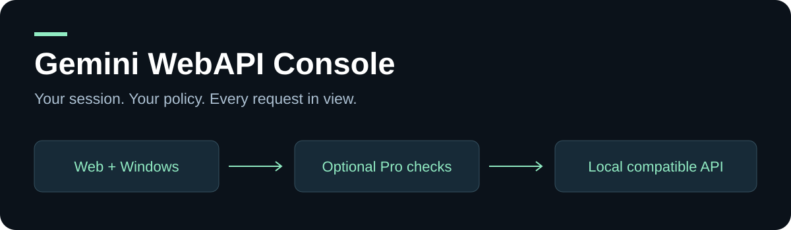
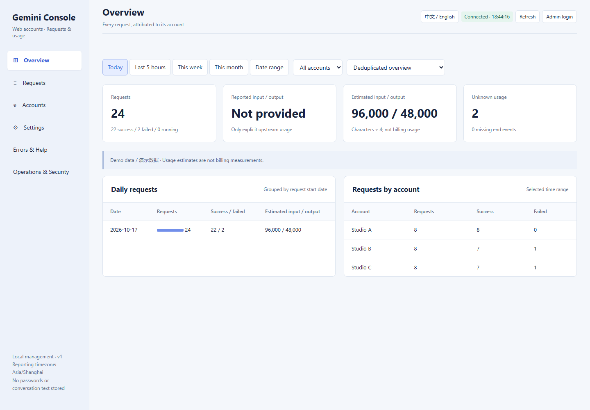
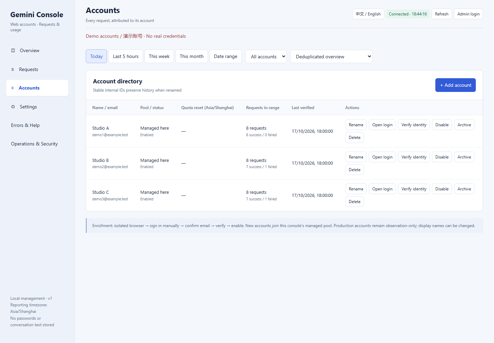

# Gemini WebAPI Console



### Your sessions. Your controls. Every request accounted for.

[简体中文](README_CN.md) · [Quick start](docs/QUICKSTART.md) · [Known limitations](docs/RELEASE_SCOPE.md) · [Changelog](CHANGELOG.md)

**0.2.0 preview — a local-first control plane for your own Gemini accounts.**
Manage dedicated browser sessions, expose text-generation APIs, inspect failures,
and understand usage without mixing your credentials with someone else's service.

> Independent community software, not a Google product or official API.
> Upstream availability, account eligibility and limits still apply. This preview
> is for public feedback, not an availability guarantee or a hosted multi-tenant service.

## What is inside?

### Cookie first. A browser path when you need it.

If Cookie generation fails while the same account still works on the Gemini
website, open its dedicated browser, verify the identity and select **Managed
browser** in Settings. Continue through the browser API without rebuilding your
client integration. Change the base URL from `8787/v1` to `8791/v1` for this mode.
This is an **explicit operator-controlled fallback**, not automatic resubmission.
Reconcile requests with unknown outcomes before switching or retrying.

**New-generation models, including Gemini 4 Argon:** refresh the model catalog
and choose the model available to your account. Both transports retain requested
model checks; an unavailable model is not silently replaced with Flash. Names,
eligibility and availability depend on upstream rollout, not this console.

## A look inside

Real dashboard screenshots with synthetic demonstration data, not measured
production performance. No real accounts or credentials are shown.



<details>
<summary>Account management: enroll, verify, enable, rename and delete</summary>



</details>

## What changed in 0.2?

This release turns the earlier gateway into a standalone local application:
installation and startup, account lifecycle, browser fallback, per-request
observability, safer error handling and operations are now documented together.
See the [bilingual release tour](docs/RELEASE_0_2.md) for the complete change list
and the [Cookie → browser recovery guide](docs/BROWSER_FALLBACK.md) for exact steps.

| Capability | What you get |
|---|---|
| Accounts | Dedicated login windows, identity verification, rename, enable/disable and deletion |
| Two local transports | Cookie API and managed browser text generation; explicit selection, no hidden fallback |
| Models | Available-model discovery, requested-model checks and no silent Flash substitution |
| Observability | Per-account calls, day/week/month/custom ranges, reported versus estimated tokens |
| Safer recovery | Queue admission, timeout boundaries, uncertain-submission protection and Cookie idempotency keys |
| Operations | Client keys, model scopes, audit events, diagnostics and drain controls |
| Desktop + web | Windows launcher and bilingual dashboard, using private local configuration |

**Strict Pro checks default to on.** Cookie checks rely on upstream metadata, not
cryptographic model identity. Managed browser mode cannot yet verify paid Pro
entitlement and requires an explicit policy choice; it does not inherit a claim
of paid authorization merely because a menu shows Pro. See the [mode guide](docs/QUICKSTART.md).

## Start in minutes

Install Python **3.11+**. On Windows:

```powershell
powershell -ExecutionPolicy Bypass -File .\Install-Windows.ps1
.\Start-Windows.bat
```

Or use the terminal:

```bash
python -m pip install -r requirements.txt
python app.py init
python app.py doctor
python app.py console
```

Open **http://127.0.0.1:8791/**. The first run generates distinct management and API
keys in private `data/settings.json`. No default shared password, no bundled
accounts, and no changes to other applications' proxy settings.

- Cookie API: `python app.py api`, default **8787/v1**.
- Managed browser API: enroll/verify accounts, select managed mode and Start API,
  then use **8791/v1**. Keep its dedicated browser tabs open.
- Existing external browser services are an advanced compatibility option, not
  a required second checkout or an automatically provisioned service.

Full installation, account enrollment, API examples and upgrades:
**[Quick start →](docs/QUICKSTART.md)**

## Understand the failure before retrying

Network interruptions and missing page controls are not proof of an invalid
account. Pre-submit failures use short backoff. Explicit account identity mismatch,
quota exhaustion and unknown submitted outcomes are separate conditions.
Never blindly resend an uncertain request or remove its protection flag.

Browser usage can be estimated, not exact upstream billing. A successful reply
does not establish translation quality. **Image generation is not supported by
this preview API.** Cookie calls can fail while the webpage still works; browser
automation can break when the upstream UI changes. See [release scope](docs/RELEASE_SCOPE.md).

## Help shape the next release

**Next: image generation.** Planned work includes image-capability discovery,
image request/result handling, downloads and clear error reporting. This is a
roadmap item, **not an available feature in 0.2**. It will ship only after
end-to-end verification; no release date is promised. We also plan broader
new-model regression coverage and clearer recovery diagnostics.

Found a new error? Open a [bug report](https://github.com/parichu1dao-crypto/Gemini-WebAPI-Console/issues/new/choose)
or email [parichu1dao@gmail.com](mailto:parichu1dao@gmail.com).
Include version, transport, OS, redacted error and whether submission occurred.
**Never attach cookies, passwords, API keys, profiles, databases or private prompts.**

Gemini 4/new-generation compatibility remains a priority as upstream support can
be verified; displayed dynamic models depend on the account. No release date or
unlimited-access promise is made. Useful reports and stars help prioritize work.

## Development and provenance

```bash
python -m unittest discover -p "test_*.py" -q
python tools/release_check.py
```

CI runs offline: it does not log into Google or consume generation quota.
[Contributing](CONTRIBUTING.md) · [Security](SECURITY.md) · [Attribution](ATTRIBUTION.md)

Includes modified code from [HanaokaYuzu/Gemini-API](https://github.com/HanaokaYuzu/Gemini-API).
The bundled **GNU AGPL v3** [license](LICENSE) and upstream notices are preserved.
No official affiliation or endorsement is implied.
