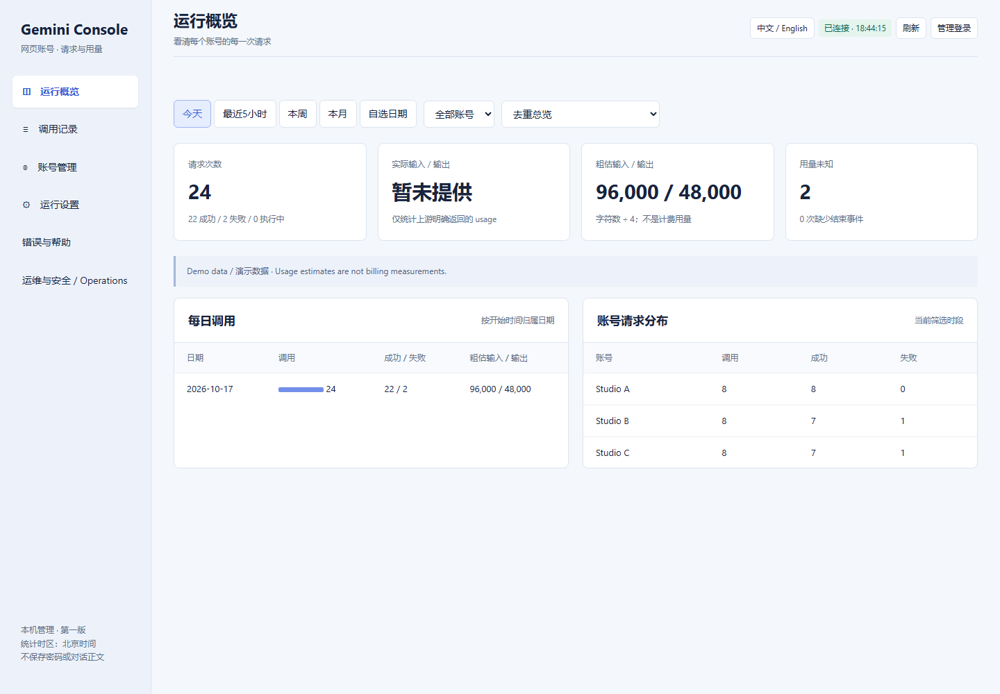

# Gemini WebAPI Console


### 你的会话，你的控制台。让每次请求都有迹可循。

[English](README.md) · [快速开始](docs/QUICKSTART.md) · [已知限制](docs/RELEASE_SCOPE.md) · [更新记录](CHANGELOG.md)

**即将推出的实验性 0.2.1：草稿 PR，不是稳定版发布。**
把登录、模型选择、调用记录、限额保护和错误诊断集中在一起，而不是遇到失败只会不停重试。

> 独立社区项目，非 Google 官方产品或官方 API。账号权限、额度及上游服务限制仍然适用。
> 本版用于收集反馈，不承诺生产 SLA，也不是多租户云服务。

## Gemini WebAPI Console 是什么？

**不要根据此 PR 切换生产环境。** 适配器代码已实现，224 项离线测试通过，已修复
长度前缀 ACK 与空路由 ID 的处理。此前三个账号的短文本实验通过，但后续集成请求
出现无响应正文超时。31,502 字符输入已实际提交，360 秒后超时，未获得回答。
**长篇翻译未验证通过，不声称翻译可用。** 新协议尚未验证最新模型。
计划创建公开草稿 PR，不是合并或发布；保留基线 `legacy` 默认值。
详见 [Cookie 协议与部署](docs/COOKIE_PROTOCOL.md)。

**这是一个开源、可自行部署的 Gemini 网页会话管理与文本 API 工具。**
它将你自己登录的 Gemini 账号接入本地服务，让脚本或兼容的聊天客户端能够发送文本请求，
同时提供统一的中英文管理台和 Windows 启动器，集中管理账号、模型、调用记录、用量与异常恢复。

项目面向需要接入 Gemini 的开发者、运行翻译与写作流程的创作者，以及需要管理多个自有账号的使用者。
它解决的不只是“能不能发出请求”，还有“到底用了哪个账号、选了什么模型、是否已经提交、
失败后能不能重试、什么时候可以恢复”这些长期运行时常见的问题。

### 工作方式

你的程序向本地 API 发送请求，服务通过所选通道调用符合条件的账号会话并返回文本。
管理台记录每次调用的时间、状态及可获得的用量信息，方便定位问题。

| 组成 | 负责什么 | 使用条件 |
|---|---|---|
| Cookie：`legacy`（默认） | 原有 Cookie HTTP 文本生成 | 有效 Cookie 与网络；每次请求不要求打开网页，但不保证上游兼容性 |
| Cookie：`process-session`（主动启用的预览） | 独立 Cookie HTTP 客户端发送 `processSession` 正文 | 必须有已录入、已登录的专用浏览器，仅用于新鲜验证和请求包准备；阻断所有浏览器生成 POST |
| 托管网页通道 | Cookie 调用失败、但网页仍正常时的备选方式 | 必须保持对应账号的专用 Chrome 窗口和 Gemini 标签页已登录、运行中 |
| 管理控制台 | 账号录入、模型设置、调用记录、用量统计与错误诊断 | 需要启动本地管理服务 |

两种调用方式由管理员明确选择，不会把结果未知的请求自动换通道重发，也不会绕过额度限制。
模型可用性取决于账号与通道。新协议仅接受已观察到的 Pro 模型 ID，其他模型以 `notSubmitted` 拒绝；
模型出现在目录里不等于新协议已支持，也不保证每个账号拥有相同权限。
**它不是 Google AI Studio / Vertex AI 官方 API，不售卖账号，也不提供无限额度。**
当前接口以文本生成为主，作图属于下一阶段计划。

**第一次使用：** 安装 → 启动管理台 → 录入并验证账号 → 选择通道和模型 →
发送一个短请求验证 → 接入自己的工作流。
具体操作请看[安装使用指南](docs/QUICKSTART.md)和[网页备选教程](docs/BROWSER_FALLBACK.md)。

## 能做什么？

### 明确选择协议，不自动重发

`cookie_protocol` 仅接受 `legacy`（默认）和 `process-session`（主动启用）。
新协议仍是 Cookie HTTP，不是托管网页生成；不会自动回退旧协议或网页生成。
浏览器仅提供新鲜验证和请求包，正文由独立 HTTP 客户端提交，该路径阻断所有浏览器生成 POST。
已提交但结果未知的请求绝不能自动重试。

本实验**仅使用 Cookie，不提供回退**。托管网页生成是独立的基线功能，不是此 PR 的恢复路径。
历史网页恢复教程不能覆盖新协议的浏览器生成 POST 阻断与模型拒绝执行规则。
不保证最新模型可用，不会静默换成 Flash。

## 界面预览

以下是实际管理台使用虚构演示数据的截图，不是生产成功率证明，不包含真实账号或密钥。



<details>
<summary>展开账号管理：录入、验证、启停、重命名与删除</summary>


</details>

## 这次更新了什么？

已有 0.2 基线从原来的网关脚本整理为可独立安装的本地应用：统一安装启动入口、账号生命周期、
网页备选通道、逐次调用统计、错误分类、限额保护与运维管理，并补全中英文说明。
完整清单见[本次发布导览](docs/RELEASE_0_2.md)，实际切换步骤见
[Cookie 失败后如何使用网页继续](docs/BROWSER_FALLBACK.md)。

| 功能 | 说明 |
|---|---|
| 账号管理 | 独立登录窗口、身份验证、重命名、启停和删除 |
| 双通道文本调用 | Cookie API 与托管网页；明确选择，不偷偷切换 |
| 模型选择 | 读取可用模型、检查请求模型，不静默降级 Flash |
| 使用统计 | 按账号及日/周/月/自选时间查看；区分真实报告与估算 Token |
| 安全恢复 | 排队准入、超时边界、未知提交保护、Cookie 请求去重 |
| 运维工具 | 调用密钥、模型权限、审计事件、诊断与排空控制 |
| 两种界面 | 双语网页管理台及 Windows 启动器 |

**严格 Pro 默认开启。** Cookie 校验依赖上游元数据，不是模型身份的独立证明。
托管网页尚不能核验付费 Pro 资格，启用该通道需管理员明确调整额外校验策略；
不能把“网页出现 Pro 菜单”当成付费授权证明，也不允许静默换模型。

## 下一步：支持作图

计划接入图像能力检测、作图请求、结果收取与下载，并完善失败提示。
**作图是下一阶段计划，不是本版已上线的能力。** 完成端到端验证后再开放，暂不承诺日期。
同时继续跟进新模型适配和会话恢复；欢迎通过 Issues 或邮件反馈实际需求。

## 安装与启动

仅限隔离实验测试，请参考[协议部署说明](docs/COOKIE_PROTOCOL.md#deployment)，不要据此升级生产环境。
保留原密钥，通过已有账号管理器录入浏览器绑定；新协议使用配置项选择，本文不声称新增了 UI 开关。

需要 Python **3.11+**。Windows 在项目目录运行：

```powershell
powershell -ExecutionPolicy Bypass -File .\Install-Windows.ps1
.\Start-Windows.bat
```

命令行方式：

```bash
python -m pip install -r requirements.txt
python app.py init
python app.py doctor
python app.py console
```

管理地址：**http://127.0.0.1:8791/**。首次运行随机生成独立管理密码和 API 密钥，
保存在私有 `data/settings.json`；不附带任何用户账号，不修改其他软件的代理。

- Cookie 接口：运行 `python app.py api`，默认 **8787/v1**。
  默认 `legacy`；主动启用 `process-session` 后还需要对应的已录入浏览器。
- 托管网页接口：在管理台录入、验证并启用账号，选择 managed 通道并启动 API，使用 **8791/v1**。
- 网页通道需要已登录的专用浏览器保持运行，不要关闭对应标签页。
- 外部网页服务只是兼容选项，不要求用户另找翻译项目或个人脚本。

账号录入、接口示例、代理和升级方法见 **[快速开始](docs/QUICKSTART.md)**。

## 不掩盖故障，也不夸大能力

已观察到上游行为变化：此前实验中的 `StreamGenerate` 在启动鉴权成功后仍失败，
但不能据此断言 Google 已全面移除旧协议。另有账号返回错误卡片；操作人员手动设置的
12 小时冷却不等于上游额度耗尽的证明。

客户端仍通过 `/v1/chat/completions` 使用相同的兼容 HTTP 请求与响应格式。
初期流式响应可能先缓存完整回答，验证通过后再输出，不承诺上游逐 Token 实时透传。

网络超时、TLS 错误、页面身份信息尚未加载，不等于账号失效。发送前故障应短暂退避；
明确身份不符、真实限额和“已提交但结果未知”分别处理。未知请求不能盲目重发或删除保护标记。

网页 Token 可能只是估算；请求成功不等于正文审核通过。**本测试版 API 不支持生图。**
Cookie 通道仍可能在网页正常时失败，网页自动化也可能受 UI 更新影响。
请先阅读 [发布范围与限制](docs/RELEASE_SCOPE.md)。

## 一起把它做好

欢迎提交 [Issue](https://github.com/parichu1dao-crypto/Gemini-WebAPI-Console/issues/new/choose)，
或联系 **[parichu1dao@gmail.com](mailto:parichu1dao@gmail.com)**。
请附版本、系统、通道、脱敏错误及是否已经提交；不要发送 Cookie、密码、密钥、浏览器目录、数据库或正文。

我们会在具备可验证条件时推进新模型适配；动态模型列表不代表新协议已支持。
最新模型尚未在新协议验证；长请求集成测试已提交后超时、无回答，不代表长篇翻译可用。
不承诺发布日期或无限额度。
如果项目对你有用，欢迎 Star；准确的故障反馈同样重要。

编辑器插入的 `U+200B` 转义仅允许出现在**行首 Markdown 列表标记紧前方**。
原始捕获载荷与证明保持不变，不进行宽泛归一化；详见协议文档。

## 开发与来源

```bash
python -m unittest discover -p "test_*.py" -q
python tools/release_check.py
```

CI 只做离线测试，不登录 Google、不消耗账号生成额度。
保留 [HanaokaYuzu/Gemini-API](https://github.com/HanaokaYuzu/Gemini-API) 来源和 **GNU AGPL v3** 许可证。
详见 [贡献指南](CONTRIBUTING.md)、[安全说明](SECURITY.md)、[来源说明](ATTRIBUTION.md) 和 [LICENSE](LICENSE)。
