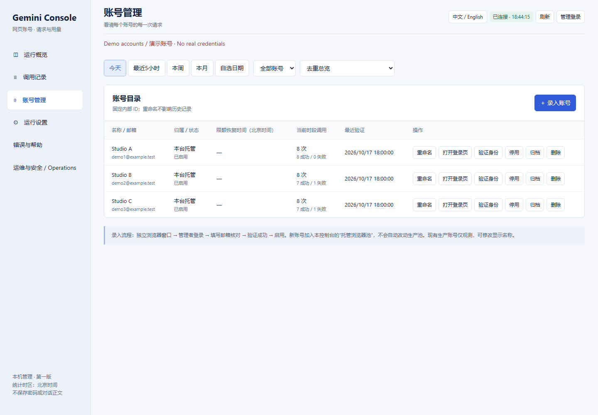

# Cookie → Browser / Cookie 失败后使用网页继续

[English](#english) · [简体中文](#简体中文) · [Home / 首页](../README.md)

## 简体中文

### 什么时候切换？

Cookie 协议调用失败，但同一账号手动打开网页仍可正常生成时，可以使用托管网页通道。
这不是额度绕过：网页同样受账号权限与限额约束。出现限额提示应等待恢复；确认身份
不一致时应修正账号绑定，不应继续发送。`submission outcome unknown` 必须先查网页
和调用记录，不能直接重发同一任务。`not_submitted` 才表示此次没有提交。

### 操作步骤

1. 打开 `http://127.0.0.1:8791/`，使用本机 `data/settings.json` 中的 `admin_key` 登录。
2. 在 **账号管理 → 录入账号** 创建独立浏览器。登录 Gemini，填写实际邮箱并验证身份，
   然后启用。默认按日期命名，也可手动命名。Cookie 账号与托管账号独立，不能假定自动同步。
3. 现有托管账号可点 **打开登录页** 重新打开专属窗口；不要使用默认浏览器里的另一个账号。
   保持 Chrome 和该标签页运行。建议将 Gemini 网页界面设为英文，便于识别模型菜单。
4. 在 **运行设置** 选择 **本台托管浏览器**。严格 Pro 默认开启，但此通道尚不能证明付费
   Pro 资格，需要管理员理解限制后明确关闭该额外校验。请求模型选择仍会检查，不静默降级。
5. 选择账号实际可用的目标模型，保存并点击 **启动 API**。选择 Argon 时，确认模型列表
   中确实有对应 ID，例如 `gemini-4-argon`；不要只根据模型自称来判断。
6. 客户端 Base URL 改为 `http://127.0.0.1:8791/v1`，使用本机 API 密钥，不是管理密码。
   先发一个短请求，核对回复与调用记录，再继续任务。Cookie API 的地址仍为 `8787/v1`。

切换只影响后续调用，不会自动找回之前的失败任务。已经发送而结果未知的请求不自动重放。
浏览器窗口不能关闭；脚本会尽量复用已有页面，但上游页面结构变化仍可能导致调用失败。

## English

### When should I switch?

Use the managed browser path when Cookie generation fails but the same account
still generates normally on the website. This does not bypass quotas or account
eligibility. Wait for quota resets and correct explicit identity mismatches.
For `submission outcome unknown`, inspect the conversation and request record
before retrying. Only `not_submitted` means this attempt was not sent.

### Steps

1. Open `http://127.0.0.1:8791/` and sign in with `admin_key` from your private
   `data/settings.json`.
2. Choose **Accounts → Add account**. Sign in to Gemini in its dedicated browser,
   verify the actual email, then enable the account. Date-based names are the
   default; custom names are supported. Cookie and managed accounts are separate.
3. For an enrolled account, use **Open login page** to reopen its dedicated
   window. Do not substitute your default browser identity. Keep Chrome and the
   Gemini tab running. English Gemini UI is recommended for menu recognition.
4. Under **Settings**, select the managed browser transport. Strict Pro defaults
   to enabled, but this transport cannot attest paid Pro entitlement; an admin
   must explicitly disable that extra check after understanding the limitation.
   Requested-model checking still applies, without silent downgrade.
5. Select an available model, save and **Start API**. For Argon, verify that its
   actual ID (for example `gemini-4-argon`) appears in the catalog. A model's own
   claim about its identity is not proof.
6. Set the client base URL to `http://127.0.0.1:8791/v1` and use the API key, not
   the management password. Send one short request, inspect its response and
   record, then resume work. The Cookie API remains at `8787/v1`.

Switching affects subsequent calls. It does not automatically recover failed
jobs or replay uncertain submissions. Keep the browser open; existing pages are
reused where possible, but upstream UI changes may still break automation.
